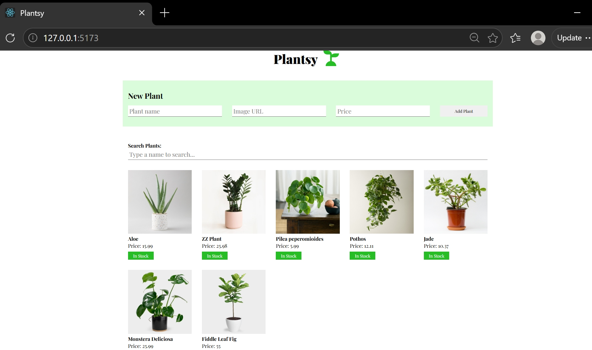

# Plantsy

A plant shop admin app built with React. It connects to a json-server backend so plants load from, and save to, a database.

## Features

- View all plants on page load
- Add a new plant with the form (saved to the backend)
- Mark a plant as sold out (not saved)
- Search plants by name

## Setup

1. Run `npm install`
2. Run `npm run server` (backend on port 6001)
3. In a new terminal, run `npm run dev`
4. Open http://127.0.0.1:5173 in your browser

## Tests

Run `npm run test`